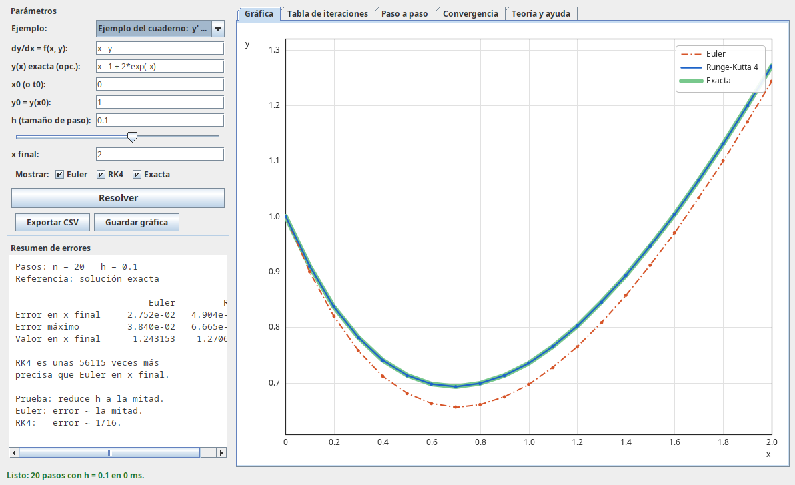
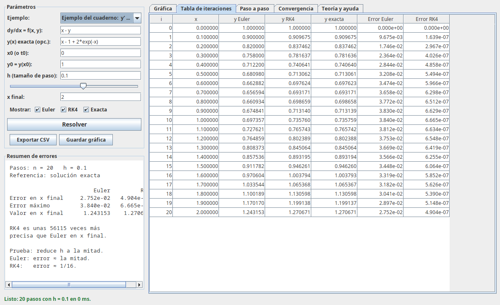
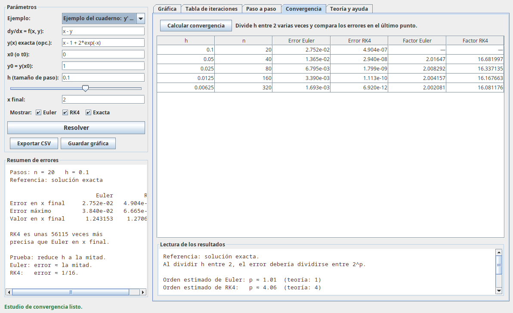

# Resolutor de EDO

Una calculadora de ecuaciones diferenciales ordinarias. Le das una ecuación del tipo
`dy/dx = f(x, y)`, un punto inicial y un tamaño de paso, y te devuelve la solución
aproximada por dos métodos: **Euler** y **Runge-Kutta de 4º orden (RK4)**. Después te
enseña la gráfica, la tabla de iteraciones y cuánto se equivocó cada método.

Lo hice para entender de verdad por qué RK4 es mejor que Euler, en lugar de solo
memorizar las fórmulas. Al final terminó siendo una herramienta bastante cómoda para
comparar métodos numéricos sin abrir MATLAB ni escribir un script cada vez.

Viene en dos versiones: una de escritorio en Java (Swing) y una para Android
(Kotlin + Jetpack Compose). Las dos usan el mismo motor de cálculo.

<p align="center">
  
</p>

Escanea el QR si quieres abrir el repo en el móvil:
`https://github.com/urreadiego0518-code/resolutor-edo`



## Qué puedes hacer con ella

- Escribir la ecuación como texto normal: `x - y`, `-0.5*(y - 20)`, `y*cos(x)`, `0.1*y*(1 - y/100)`.
- Poner la solución exacta si la conoces (opcional). Si no, el error se mide contra un RK4 con paso 20 veces más chico.
- Mover el deslizador de `h` y ver en vivo cómo cambia el error. Es la parte divertida: al reducir `h` a la mitad, el error de Euler baja a la mitad y el de RK4 a un dieciseisavo.
- Ver el paso a paso de RK4: de dónde sale cada `k1`, `k2`, `k3`, `k4` y cómo se combinan.
- Comparar los tres trazos (Euler, RK4 y exacta) en la misma gráfica, con el ratón encima para leer coordenadas.
- Exportar la tabla a CSV o guardar la gráfica como PNG.
- Usar los ejemplos que ya vienen cargados: el del cuaderno, caída con paracaídas, circuito RC, crecimiento logístico, enfriamiento de Newton y uno oscilante donde Euler se despeina.

| Tabla de iteraciones | Convergencia |
|---|---|
|  |  |

## Descargar y usar

En la sección de [Releases](../../releases) están los binarios listos para ejecutar:

| Sistema | Archivo |
|---|---|
| Windows | `ResolutorEDO-windows.zip` (trae su propio Java, no hay que instalar nada) |
| Linux | `ResolutorEDO-linux.tar.gz` (trae su propio Java) |
| Cualquier sistema | `ResolutorEDO.jar` (necesita Java 17 o superior) |
| Android | `ResolutorEDO.apk` (Android 7.0 en adelante) |

En Android hay que permitir la instalación desde "orígenes desconocidos", porque el APK
no viene de Play Store.

Sobre iOS: no hay versión. La app de Android es nativa de Android y portarla a iOS
implica reescribir la interfaz completa en Swift, así que por ahora no existe. Si
alguien quiere intentarlo, el motor de cálculo está separado de la interfaz justo para
facilitar ese trabajo.

## Cómo está armado

### Escritorio (`desktop-java/`)

Proyecto de NetBeans con Ant, sin dependencias externas. Todo es Java puro y `Graphics2D`.

| Archivo | Qué hace |
|---|---|
| `Metodos.java` | El núcleo: `euler()` y `rk4()`, más el texto del paso a paso. |
| `Expresion.java` | Convierte el texto de la ecuación en una función `f(x, y)`. Un parser pequeño hecho a mano. |
| `Ejemplo.java` | El catálogo de problemas precargados. |
| `PanelGrafica.java` | Dibuja la gráfica con `Graphics2D`, sin librerías. |
| `VentanaPrincipal.java` | La interfaz Swing y las pestañas. |
| `Main.java` | Punto de entrada. |

Se puede compilar a mano sin NetBeans:

```bash
cd desktop-java
javac -encoding UTF-8 -d out $(find src -name "*.java")
java -cp out edo.Main
```

O con los scripts `compilar_y_ejecutar.sh` / `.bat` que están en la carpeta. Los tests
viven en `desktop-java/test/` y también corren con Java puro.

### Android (`android/`)

Kotlin con Jetpack Compose, Gradle Kotlin DSL. `EdoEngine.kt` es el mismo motor de
cálculo portado a Kotlin, y `MainActivity.kt` tiene la interfaz con pestañas.

```bash
cd android
./gradlew assembleDebug
```

El APK queda en `app/build/outputs/apk/debug/`.

## Los métodos, en corto

Euler avanza con una sola pendiente:

```
y(i+1) = y(i) + h * f(x(i), y(i))
```

RK4 promedia cuatro pendientes dentro del mismo paso (`k1` en el inicio, `k2` y `k3` a
la mitad, `k4` al final) y las combina con pesos 1-2-2-1. Cuesta cuatro evaluaciones por
paso en lugar de una, pero el error baja de orden `h` a orden `h^4`. Por eso con el mismo
`h` la diferencia es tan grande.

## Estado

Funciona y está probado con los ejemplos que incluye. Le faltan cosas que estaría bien
tener: sistemas de ecuaciones (para modelo SIR o tiro parabólico), más métodos
(Heun, punto medio) y exportar la gráfica en SVG. Si encuentras un error o quieres
agregar algo, abre un issue o manda un pull request.

## Licencia

MIT. Úsalo, modifícalo y compártelo como quieras.
